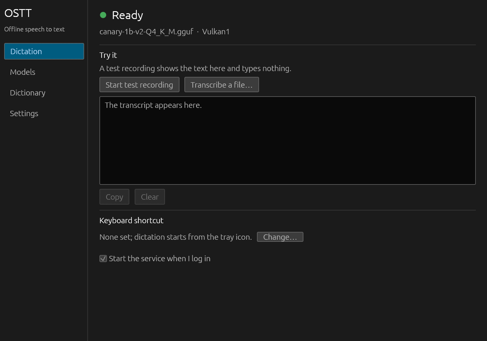
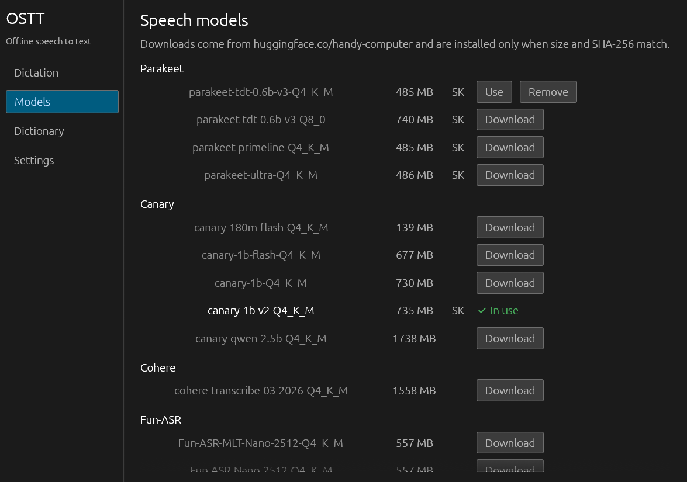

# ostt-desktop

Offline speech to text for the Linux desktop: press a key, speak, press it again, and the text
is typed into the focused window. Recognition runs on this machine.

## Based on

This is a Linux desktop port of **Offline Speech to Text (OSTT) for Android** by Noah Mühl:

- Source: https://gitworkshop.dev/npub1jg2qmt3rxjksq65v3nk7dq6yaz2c4uf3qt9epdhxwms2xwd47j2s38a228/relay.ngit.dev/offline-speech-to-text
- Git: `https://relay.ngit.dev/npub1jg2qmt3rxjksq65v3nk7dq6yaz2c4uf3qt9epdhxwms2xwd47j2s38a228/offline-speech-to-text.git`
- Android app: https://zapstore.dev/apps/app.offlinespeechtotext
- Licence: MIT. Ported from upstream commit `5cf11c5`.

What comes from upstream:

- `src/core/` is copied unchanged: silence detection, long-recording windows, the dictionary,
  exact corrections and transcript cleanup, with their tests.
- `src/engine.rs` is adapted from the upstream engine.
- `src/catalog.rs` is generated from the upstream model catalogue (55 pinned models).

Everything else replaces the Android layer: PipeWire capture, a background service with a tray
icon, typing into the focused window, and the settings window. Recognition itself is
[transcribe.cpp](https://github.com/handy-computer/transcribe.cpp); the models are the GGUF
builds published at https://huggingface.co/handy-computer and carry their own licences.

## Status

v0.1, developed and tested on one machine: Pop!_OS 24.04 with the COSMIC desktop (Wayland),
x86_64. Typing uses `wtype`, so it needs a Wayland compositor that supports virtual keyboards.
The shortcut field writes COSMIC's configuration; on other desktops bind `ostt toggle` yourself.

## Build

Needs Rust 1.92 or newer, cmake, a C++ compiler, `libvulkan-dev` and `glslc`.

    scripts/fetch-spirv-headers.sh    # once; skip if spirv-headers is installed system-wide
    cargo build --release
    ./install.sh                      # links ~/.local/bin/ostt, installs the systemd user unit

Runtime tools: `pw-record` (PipeWire), `wtype`, `wl-copy`, `notify-send`, `curl`.
Files other than 16 kHz mono WAV need `ffmpeg` or `gst-launch-1.0`.

## Use

    ostt download                 # default model, verified by size and SHA-256
    systemctl --user start ostt   # or: ostt daemon
    ostt shortcut set Super+Alt+D # or pick it in the settings window; `ostt shortcut clear` removes it

The tray icon shows the state; clicking it does the same as `ostt toggle`.
`ostt gui` (or "Offline Speech to Text" in the app launcher, or Settings… in the tray menu) opens
the settings window: a test dictation, file transcription, models, dictionary and settings.
`ostt help` lists every command, `ostt config` every setting.

| File | Purpose |
|---|---|
| `~/.config/ostt/config` | settings (`key = value`) |
| `~/.config/ostt/custom_terms` | preferred words or phrases, one per line |
| `~/.config/ostt/personal_corrections` | `heard => written`, one per line |
| `~/.local/share/ostt/models/` | speech models (GGUF) |

## Notes

- Canary models need a language (`ostt config set language sk`). Without one, Canary 1B v2
  translated the Slovak test recording into English.
- `device = auto` picks the integrated GPU, then a discrete GPU, then the CPU. `ostt bench
  <audio>` times the selected model on each.
- Typing uses `wtype`. If it fails, the text is put on the clipboard instead.
- Transcripts are never logged; the service log holds timings only.

## Shortcut

On COSMIC the shortcut is written to the desktop's own custom-shortcut file
(`~/.config/cosmic/com.system76.CosmicSettings.Shortcuts/v1/custom`); other entries there are
kept as they are, and the file as it was before the first change is saved to
`~/.local/state/ostt/cosmic-shortcuts-custom.before-ostt`. A combination is refused when the
desktop already uses it, when applications use it (Ctrl+C), or when it would fire while typing.
On other desktops, bind `ostt toggle` in the desktop's keyboard settings.

`patches/egui-winit` is [egui-winit](https://github.com/emilk/egui) 0.35.0 (MIT OR Apache-2.0)
with one line changed: upstream drops the Super modifier on Linux, and the shortcut field needs it.

## Not ported

Live subtitles, language-detector setup beyond `ostt download langid`,
and the Android integration APIs.

## Licence

MIT, see [LICENSE](LICENSE). The English word list in `src/core/` comes from SCOWL and Faker
(see `src/core/sound_alike_words_en.LICENSE`); the Slovak test recording is from Google FLEURS,
CC BY 4.0 (see `tests/data/fleurs-sk-LICENSE.txt`).
